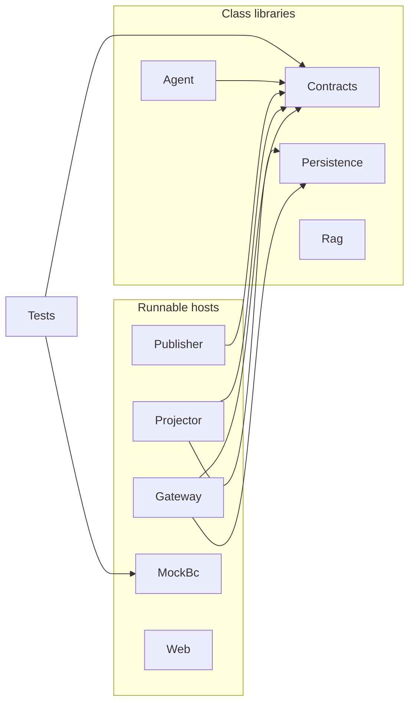

# OpsBound architecture

ERP-adjacent agent gateway. Business Central is mocked. Kafka is on the path: produce, project, exception, then a gated agent proposal.

Local broker is Redpanda in Docker Compose. Hosted environments use Azure Event Hubs (Kafka protocol) with the same topic names and the same Confluent.Kafka client. Azure AI Search is not part of this build.

## Components

| Component | Responsibility |
| --- | --- |
| OpsBound.Web | Blazor Interactive Server ops console |
| OpsBound.Gateway | Chat, tool dispatch, approvals, audit APIs |
| OpsBound.Agent | Prompt and tool loop. Mutating tools stop at approval |
| OpsBound.Rag | Chunk, embed, and retrieve policy docs with citations |
| OpsBound.MockBc | OData-shaped customers, invoices, items, stock, orders |
| OpsBound.Contracts | Event envelope and topic names |
| OpsBound.Persistence | EF Core model for Gateway and Projector, including pgvector embeddings |
| OpsBound.Publisher | Seed and burst POS and inventory events |
| OpsBound.Projector | Consume Kafka, update projected stock, emit exceptions |

Local ports: Kafka `localhost:19092`, Redpanda Console `http://localhost:8080`, Postgres `localhost:5433` (container port 5432).

Diagrams: [Postgres store](diagrams/persistence-erd.md), [mock Business Central](diagrams/mock-bc-erd.md).

## Project references

A class library compiles to a DLL. Gateway, MockBc, Web, Publisher, and Projector are the hosts you can start with `dotnet run`. An arrow below is a compile-time project reference. MockBc, Web, and Rag have none. Tests reference Contracts and MockBc.

| Project | Kind | What it does today |
| --- | --- | --- |
| Contracts | Library | Shared topic names and the event envelope. Publisher, Projector, Gateway, and Agent depend on it so they share one event shape. |
| Persistence | Library | EF Core model, the `InitialCreate` migration, and `AddOpsBoundPersistence`. Gateway and Projector both open this database. |
| Agent | Library | Marker for the later tool loop. It references Contracts. |
| Rag | Library | Marker for later chunking and retrieval. It does not reference Persistence yet. |
| Gateway | Web host | Migrates the database on startup and serves `/health`. Chat, tools, and approvals come later. |
| Projector | Worker | Registers the database context. Its worker stays idle until Kafka consumption is added. It does not migrate. |
| Publisher | Worker | References Contracts only. Idle until it produces POS and inventory events. |
| MockBc | Web host | In-memory Business Central-shaped API for company `opsbound`. No database. |
| Web | Blazor host | Interactive Server shell. It does not call Gateway yet. |
| Tests | Test project | Contract tests and MockBc endpoint tests. |

## Topics

| Topic | Producers | Consumers | Key |
| --- | --- | --- | --- |
| `retail.pos.v1` | Publisher | Projector | `storeId:sku` or `orderId` |
| `retail.inventory.v1` | Publisher | Projector | `sku` |
| `ops.exceptions.v1` | Projector | Gateway, Blazor via API | `exceptionId` |
| `ops.agent.commands.v1` | Gateway after approval | Optional mock BC writer | `commandId` |
| `ops.dlq.v1` | Consumers on poison messages | Ops tooling | original key |

Records use a CloudEvents-style envelope: `id`, `type`, `source`, `time`, `data`. Samples and a JSON schema live in `contracts/events/`. Consumer group for inventory projection is `opsbound-inventory`, with idempotency on `event_id`. That consumer is a later phase. Embeddings are a `vector(1536)` column on `Chunks`, not a separate table.
