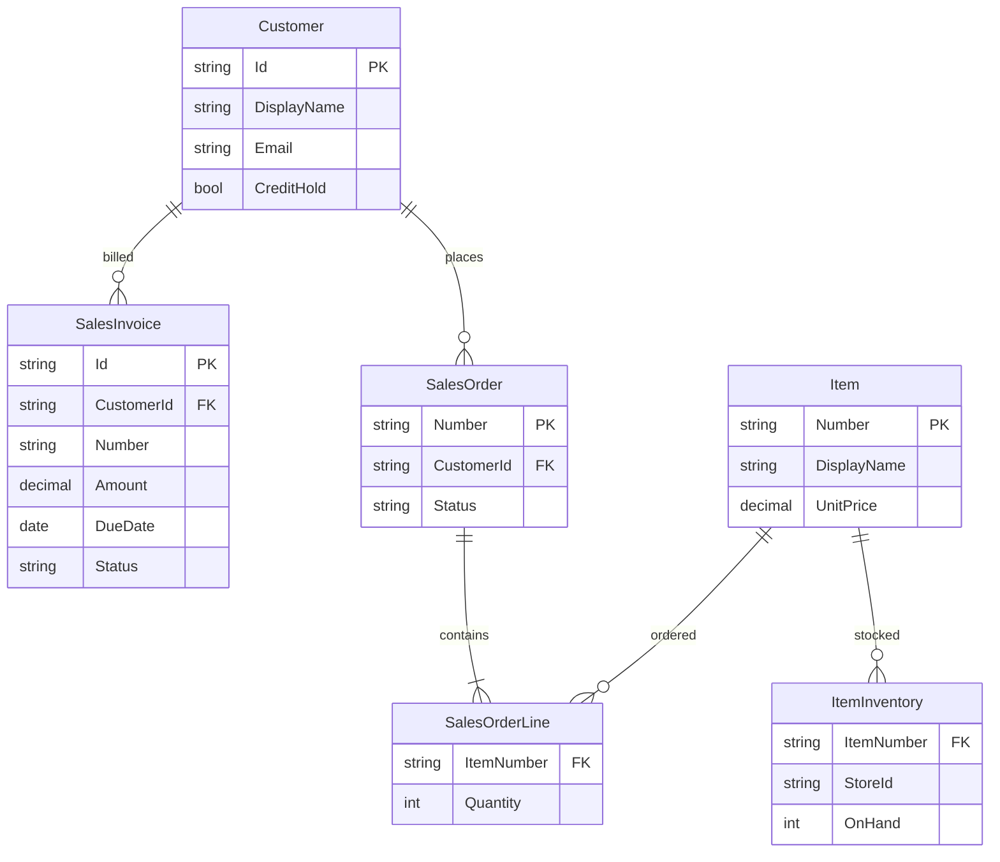

# Mock Business Central

In-memory seed for company `opsbound`. These are not Postgres tables.

`SalesOrderLine` belongs to one order and names one item. `ItemInventory` is the on-hand quantity for an item at a store.
