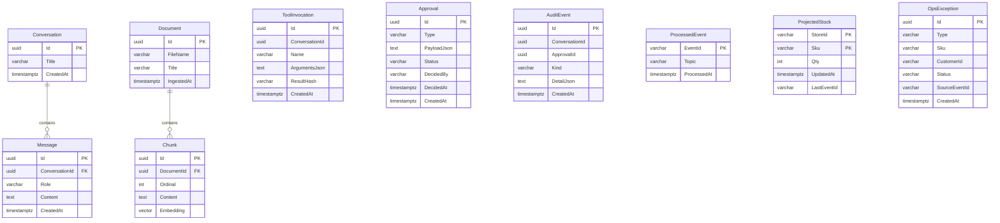

# Postgres store

Tables created by `InitialCreate` in database `opsbound`. Only `Message` → `Conversation` and `Chunk` → `Document` are foreign keys. Other id columns are stored without a database constraint.

`Chunk.Embedding` is `vector(1536)`. `ProjectedStock` is keyed by store and SKU. `OpsException` is stored in the table `Exceptions`.
